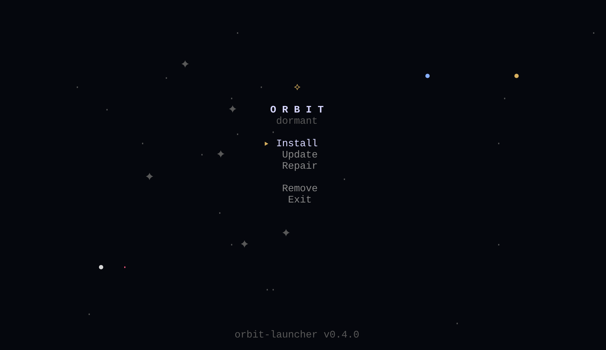
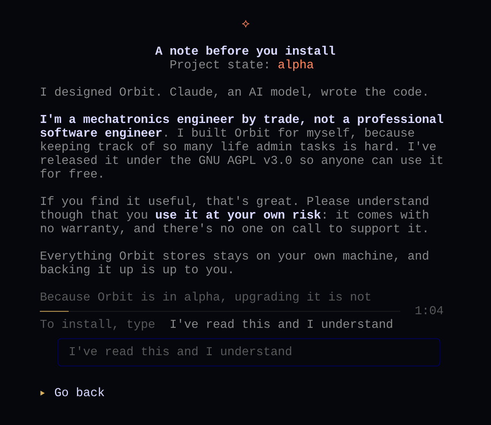
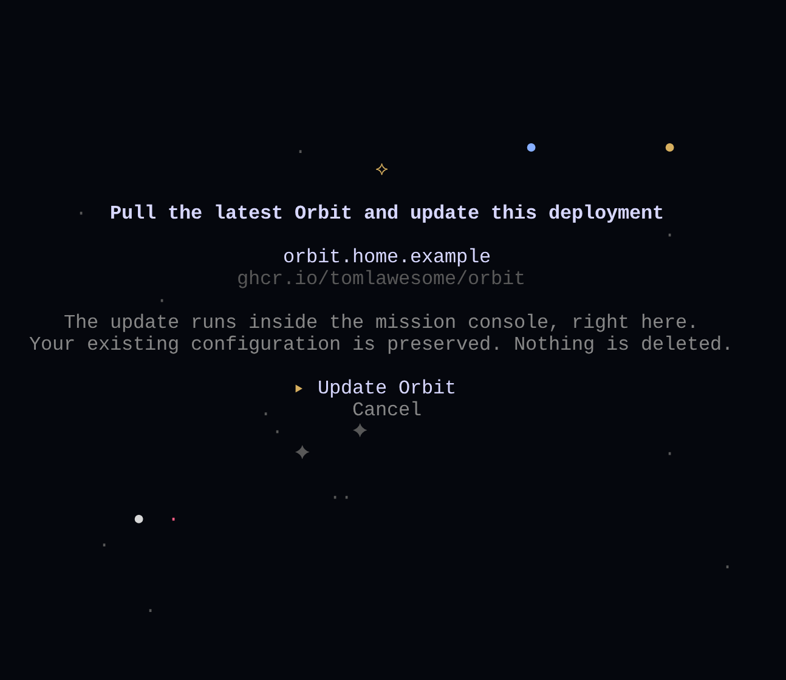

> [!IMPORTANT]
> **Development disclosure:** orbit-launcher was coded by Claude under human
> direction.

<h3>
  <a href="https://tomlawesome.github.io/orbit-site/">Website</a>
  &nbsp;&nbsp;·&nbsp;&nbsp;
  <a href="https://github.com/tomlawesome/orbit-launcher/security/policy">Report a vulnerability</a>
  &nbsp;&nbsp;·&nbsp;&nbsp;
  <a href="https://github.com/tomlawesome/orbit-launcher/blob/main/LICENSE">Licence</a>
</h3>

  <strong>orbit-launcher</strong> 
  The part of Orbit that sets it up and looks after it on your server.

 

  

&nbsp;

## What it is

orbit-launcher is the full-screen terminal program that installs, updates,
repairs and removes Orbit on the server that hosts it. Orbit's install line
downloads it, checks it and starts it for you.

## What you need

- **A Linux server.** Orbit's download script stops on any other system, and
  on anything but 64-bit x86 or arm64. Orbit itself is built for 64-bit x86
  (amd64) only for now, so use amd64. The launcher is tested by installing
  Orbit on Ubuntu and on Fedora.
- **Docker with Compose v2.** Plus `curl`, `openssl`, `tar`, `sha256sum`,
  `base64` and GNU `timeout`, which most Linux systems already have.
- **A normal user account that can use Docker.** The launcher refuses to run
  as root, with or without `sudo`.
- **Memory.** The launcher counts 6 GiB for Standard: Orbit's 2 GiB and the
  malware scanner's 4 GiB memory limits. The database and the system need
  memory on top of that. Documents adds a 1 GiB attachment reader, 7 GiB in
  all. The launcher reads the machine's total memory on Linux and will not
  start Documents when it is under 7 GiB. It never blocks Standard.
- **Ports.** Orbit listens on port 3000 on every network interface unless
  you change `ORBIT_PORT` or `ORBIT_BIND_ADDRESS` in `.env-orbit`. Put an
  HTTPS reverse proxy in front of it. Never expose Orbit directly to the
  internet. [Installing Orbit](https://github.com/tomlawesome/orbit/blob/main/docs/installing.md)
  covers the proxy.
- **Disk.** No minimum is documented. If Orbit fails to start, the installer
  reports the free space on the install folder and on Docker's data folder.
- **Internet access** to GitHub (the install files and the launcher's
  update check), to GitHub's container registry (ghcr.io, for Orbit's image)
  and to Docker Hub (for the database, scanner and attachment-reader
  images). While Orbit runs, the scanner also downloads its signature
  updates. Set `ORBIT_LAUNCHER_NO_UPDATE_CHECK` to any non-empty value to
  skip the launcher's update check.

## Install, then claim

The short version. [Installing Orbit](https://github.com/tomlawesome/orbit/blob/main/docs/installing.md)
has the full requirements and explains the sign-in questions. Its menu and
profile names are those of Orbit's plain installer, not the launcher's.

1. Set up the HTTPS reverse proxy for Orbit's public address first
   (Installing Orbit covers its settings). The claim link opens that
   address, so it must already reach Orbit on port 3000.
2. Make an empty folder for Orbit and open a terminal in it. The launcher
   works on the folder it is started from.
3. Run the install line from Installing Orbit. It checks the signed release
   and starts the launcher.
4. Choose **Install**, then a profile: **Standard** or **Documents**. The
   Agent and Full rows show "not yet".
5. Read the note about Orbit's state and risks. After a 20-second countdown, and once you have scrolled to the end,
   type `I've read this and I understand` to go on.
6. Watch the install run in the launcher's console. Orbit then asks for its
   settings (its public address, how people sign in) in that console, or briefly hands you the terminal to answer.
7. On the final screen, the address shows as **alive** and **unclaimed**.
   Choose **Get into Orbit** to open the claim link, or **Copy claim link**
   if the server has no browser (your terminal must allow clipboard writes). Whoever opens the link first creates the
   first administrator, so open it yourself. If no link shows, run
   `docker compose --env-file .env-orbit logs orbit-app` in the folder and
   open the link Orbit printed.

After that, export a recovery bundle, as Installing Orbit explains.

## Update and Repair

Run the install line again from the Orbit folder and choose:

- **Update** pulls the latest Orbit and updates this deployment, keeping its
  configuration. The launcher takes no backup, and Orbit's note says an upgrade may not
  keep your data, so back up first (see the link at the end). One-step update with a backup, a health check
  and rollback is planned (issue #317 in the launcher's GitLab project, update in one step).
- **Repair** runs the deployment's own `scripts/repair.sh` to diagnose it
  and shows what a fix would do. It changes nothing until you agree, and
  offers only the actions the plan proposes. It cannot yet start services
  that failed to start: issue #256 in the launcher's GitLab project.

## What Remove deletes

Remove works in two steps, and the launcher runs only the first.

1. **Stand down** (the launcher runs this after you confirm). It runs
   `docker compose down`: it stops Orbit and removes its containers and
   network. It deletes no files, no data volumes and no images.
2. **The removal command** (you decide whether to run it). The launcher
   shows a command and offers to copy it, but never runs it. It is
   `docker compose … down -v && sudo rm -rf <your Orbit folder>`. It
   deletes the data volumes (the database, with its mail, and the documents and scanner volumes) and the whole folder:
   configuration, secrets, backups and anything else you put there. It
   cannot be undone. It leaves Docker images alone.

If the folder is the root folder or your home folder, the launcher offers
only the data-volume half and leaves the folder for you. Removing the data
volumes matters: a database volume left behind makes a later install stop.

Remove acts only on the Orbit found in the folder you start the launcher
in. A change so that Remove deletes only Orbit's own files, and keeps
everything else in the folder, is planned:
issue #285 in the launcher's GitLab project.

## Upgrades and backups

[Upgrades and backups](https://github.com/tomlawesome/orbit/blob/main/docs/upgrades-and-backups.md)
explains how to back up Orbit before an update and how to restore.

## Options

`orbit-launcher --version` prints its version. `orbit-launcher --licences`
prints the licences of what it includes. `ORBIT_LAUNCHER_NO_ANIMATION`, set
to any non-empty value, skips the opening animation.

## For contributors

The launcher is not currently taking outside code changes: see
[CONTRIBUTING.md](CONTRIBUTING.md). Build it with
`go build ./cmd/orbit-launcher` and test it with `go test -race ./...`.
[docs/releasing.md](docs/releasing.md) says how releases are made and
[docs/implementation-plan.md](docs/implementation-plan.md) describes the
code. Orbit builds and signs the launcher with each Orbit release; this
repository holds its source, tests and version tags.

`TestLive_UpdateExistingDeployment` (build tag `live`, #331) updates a
deployment somebody else installed and leaves it running, for Orbit's upgrade
cell (ai/orbit#1666). It is skipped unless `ORBIT_LIVE_EXISTING_DIR` is set;
then `ORBIT_RELEASE_MANIFEST`, `ORBIT_LAUNCHER_LIVE_BINARY` and
`ORBIT_LAUNCHER_INSTALL_SCRIPT_PATH` (or `_URL`) are required, and
`ORBIT_LAUNCHER_LIVE_RAW_LOG` is optional. See issue #331 for the interface.
